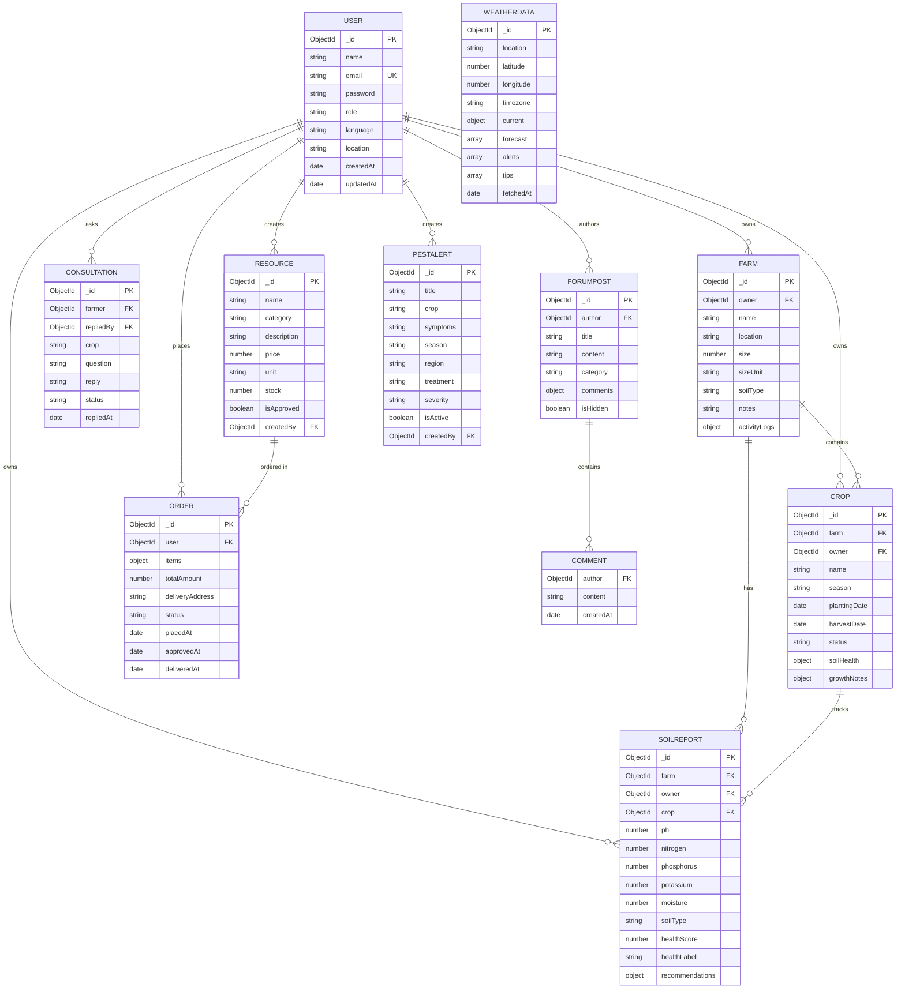

# AgriTech — Database Schemas

MongoDB (Mongoose) schema reference for the AgriTech platform.

Source of truth: `server/models/*.js`

- **Database:** MongoDB (local or Atlas)
- **ODM:** Mongoose 8
- **Conventions:** every collection uses `timestamps: true` unless noted; `_id` is an auto-generated `ObjectId`.

---

## Entity-Relationship Diagram

---

## Collections

### 1. User — `users`

A user is either a `farmer` or an `admin`.

| Field | Type | Constraints / Default |
| --- | --- | --- |
| `name` | String | required, trimmed, max 80 |
| `email` | String | required, unique, lowercase, trimmed, valid email |
| `password` | String | required, min 6, `select: false`, bcrypt-hashed on save |
| `role` | String | enum `farmer` \| `admin`, default `farmer` |
| `language` | String | enum `en` \| `hi` \| `ta`, default `en` |
| `location` | String | trimmed, default `''` |
| `createdAt` / `updatedAt` | Date | auto |

**Indexes:** `{ role: 1, createdAt: -1 }`, unique on `email`.

**Methods:** `matchPassword(candidate)`, `toJSON()` (strips password).

---

### 2. Farm — `farms`

Each farm belongs to exactly one farmer.

| Field | Type | Constraints / Default |
| --- | --- | --- |
| `owner` | ObjectId → User | required, indexed |
| `name` | String | required, max 100 |
| `location` | String | required, max 150 |
| `size` | Number | required, min 0.01 |
| `sizeUnit` | String | enum `acre` \| `hectare`, default `acre` |
| `soilType` | String | enum `clay` \| `sandy` \| `loamy` \| `silt` \| `peaty` \| `chalky` \| `other`, default `loamy` |
| `notes` | String | max 1000, default `''` |
| `activityLogs[]` | Embedded | `{ message: String(required, max 500), date: Date }` (`_id: false`) |

**Indexes:** `{ owner: 1, createdAt: -1 }`, text on `name` + `location`.

---

### 3. Crop — `crops`

Soil health is stored as a snapshot on every crop.

| Field | Type | Constraints / Default |
| --- | --- | --- |
| `farm` | ObjectId → Farm | required, indexed |
| `owner` | ObjectId → User | required, indexed |
| `name` | String | required, max 80 |
| `season` | String | enum `Kharif` \| `Rabi` \| `Zaid` \| `All year`, default `Kharif` |
| `plantingDate` | Date | required |
| `harvestDate` | Date | optional |
| `status` | String | enum `planned` \| `growing` \| `harvested` \| `failed`, default `planned` |
| `soilHealth` | Object | `ph` (0–14), `nitrogen`, `phosphorus`, `potassium` (≥0), `moisture` (0–100), `soilType` enum |
| `growthNotes[]` | Embedded | `{ note: String(required, max 1000), date: Date }` (`_id: false`) |

**Indexes:** `{ owner: 1, status: 1, createdAt: -1 }`, `{ farm: 1, name: 1 }`.

---

### 4. SoilReport — `soilreports`

History of soil analyses for a farm.

| Field | Type | Constraints / Default |
| --- | --- | --- |
| `farm` | ObjectId → Farm | required, indexed |
| `owner` | ObjectId → User | required, indexed |
| `crop` | ObjectId → Crop | optional, default `null` |
| `ph` | Number | required, 0–14 |
| `nitrogen` | Number | required, ≥0 |
| `phosphorus` | Number | required, ≥0 |
| `potassium` | Number | required, ≥0 |
| `moisture` | Number | required, 0–100 |
| `soilType` | String | enum (same as Farm), default `loamy` |
| `healthScore` | Number | 0–100 |
| `healthLabel` | String | enum `poor` \| `fair` \| `good` \| `excellent` |
| `recommendations` | Object | `crops[]`, `fertilizers[]`, `notes[]` (String arrays) |

**Indexes:** `{ farm: 1, createdAt: -1 }`, `{ owner: 1, createdAt: -1 }`.

---

### 5. Resource — `resources`

Catalog of seeds, fertilizers, tools and pesticides. New resources require admin approval.

| Field | Type | Constraints / Default |
| --- | --- | --- |
| `name` | String | required, max 100 |
| `category` | String | enum `seeds` \| `fertilizer` \| `pesticide` \| `tool` \| `other`, required, indexed |
| `description` | String | max 1000, default `''` |
| `price` | Number | required, ≥0 |
| `unit` | String | default `unit`, max 30 |
| `stock` | Number | default 0, ≥0 |
| `isApproved` | Boolean | default `false`, indexed |
| `createdBy` | ObjectId → User | optional |

**Indexes:** `{ category: 1, isApproved: 1, price: 1 }`, text on `name` + `description`.

---

### 6. Order — `orders`

Status flow: `pending → approved → delivered` (or `rejected` / `cancelled`).

| Field | Type | Constraints / Default |
| --- | --- | --- |
| `user` | ObjectId → User | required, indexed |
| `items[]` | Embedded | at least 1 item |
| `items[].resource` | ObjectId → Resource | required |
| `items[].name` | String | required |
| `items[].price` | Number | required, ≥0 |
| `items[].quantity` | Number | required, ≥1 |
| `totalAmount` | Number | required, ≥0 |
| `deliveryAddress` | String | required, max 300 |
| `status` | String | enum `pending` \| `approved` \| `delivered` \| `rejected` \| `cancelled`, default `pending` |
| `placedAt` | Date | default `Date.now` |
| `approvedAt` | Date | optional |
| `deliveredAt` | Date | optional |

**Indexes:** `{ user: 1, createdAt: -1 }`, `{ status: 1, createdAt: -1 }`.

---

### 7. PestAlert — `pestalerts`

Pest/disease alerts filterable by crop, season and region.

| Field | Type | Constraints / Default |
| --- | --- | --- |
| `title` | String | required, max 150 |
| `crop` | String | required, indexed |
| `symptoms` | String | required, max 1000 |
| `season` | String | enum `Kharif` \| `Rabi` \| `Zaid` \| `All year`, default `All year` |
| `region` | String | required, default `All regions`, indexed |
| `treatment` | String | required, max 1000 |
| `severity` | String | enum `low` \| `medium` \| `high`, default `medium` |
| `isActive` | Boolean | default `true`, indexed |
| `createdBy` | ObjectId → User | optional |

**Indexes:** `{ crop: 1, region: 1, season: 1, isActive: 1 }`, text on `title` + `symptoms` + `treatment`.

---

### 8. Consultation — `consultations`

One-to-one expert consultation between a farmer and an expert (admin).

| Field | Type | Constraints / Default |
| --- | --- | --- |
| `farmer` | ObjectId → User | required, indexed |
| `repliedBy` | ObjectId → User | default `null` |
| `crop` | String | default `''` |
| `question` | String | required, max 2000 |
| `reply` | String | max 2000, default `''` |
| `status` | String | enum `open` \| `answered` \| `closed`, default `open`, indexed |
| `repliedAt` | Date | optional |

**Indexes:** `{ status: 1, createdAt: -1 }`.

---

### 9. ForumPost — `forumposts`

Community forum posts with flat comments and a moderation flag.

| Field | Type | Constraints / Default |
| --- | --- | --- |
| `author` | ObjectId → User | required, indexed |
| `title` | String | required, max 150 |
| `content` | String | required, max 5000 |
| `category` | String | enum `General` \| `Crops` \| `Pests` \| `Weather` \| `Marketing` \| `Other`, default `General` |
| `comments[]` | Embedded | `{ author: ObjectId → User (required), content: String(required, max 1000), createdAt, updatedAt }` |
| `isHidden` | Boolean | default `false`, indexed |

**Indexes:** `{ isHidden: 1, createdAt: -1 }`, text on `title` + `content`.

---

### 10. WeatherData — `weatherdatas`

Cached weather responses so repeated lookups do not hit the public API.

| Field | Type | Constraints / Default |
| --- | --- | --- |
| `location` | String | required, lowercase, trimmed |
| `latitude` | Number | optional |
| `longitude` | Number | optional |
| `timezone` | String | default `auto` |
| `current` | Mixed | current conditions payload |
| `forecast[]` | Mixed | daily forecast entries |
| `alerts[]` | String | weather alerts |
| `tips[]` | String | farming tips |
| `fetchedAt` | Date | default `Date.now` |

**Indexes:** `{ location: 1, fetchedAt: -1 }`.

---

## Relationship Summary

| From | To | Field | Cardinality |
| --- | --- | --- | --- |
| User | Farm | `Farm.owner` | one-to-many |
| User | Crop | `Crop.owner` | one-to-many |
| User | SoilReport | `SoilReport.owner` | one-to-many |
| User | Order | `Order.user` | one-to-many |
| User | Consultation | `Consultation.farmer` / `repliedBy` | one-to-many |
| User | ForumPost | `ForumPost.author` / `comments.author` | one-to-many |
| User | Resource | `Resource.createdBy` | one-to-many |
| User | PestAlert | `PestAlert.createdBy` | one-to-many |
| Farm | Crop | `Crop.farm` | one-to-many |
| Farm | SoilReport | `SoilReport.farm` | one-to-many |
| Crop | SoilReport | `SoilReport.crop` | one-to-many |
| Resource | Order | `Order.items[].resource` | many-to-many |
| ForumPost | Comment | `ForumPost.comments` | one-to-many (embedded) |
